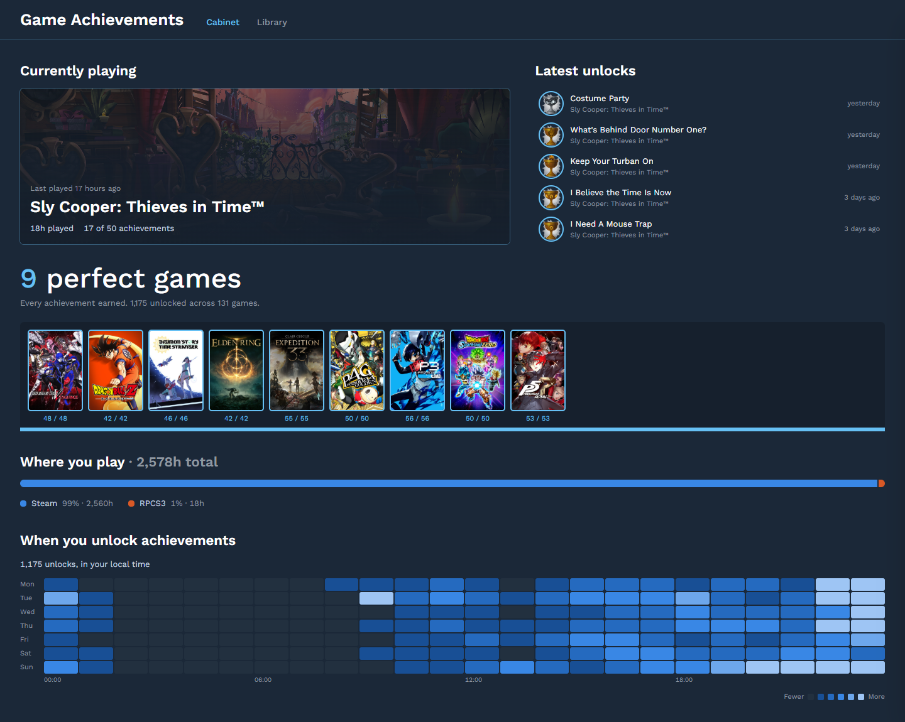
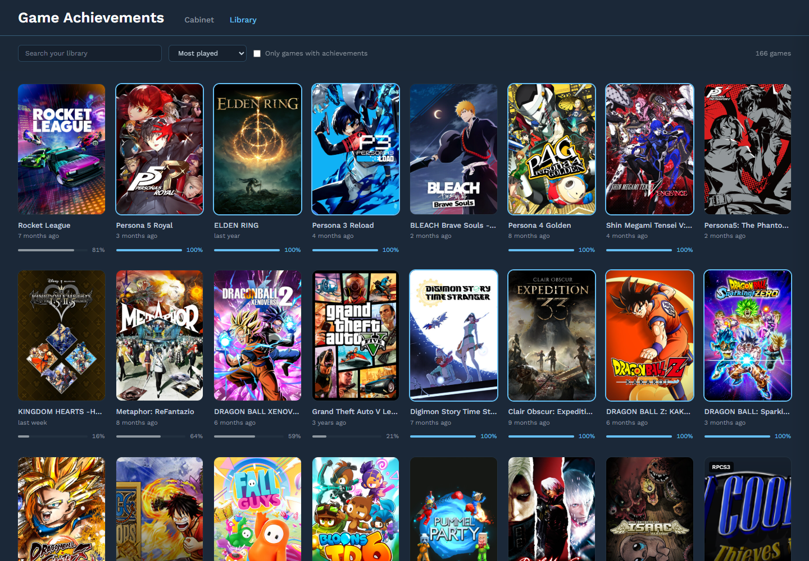
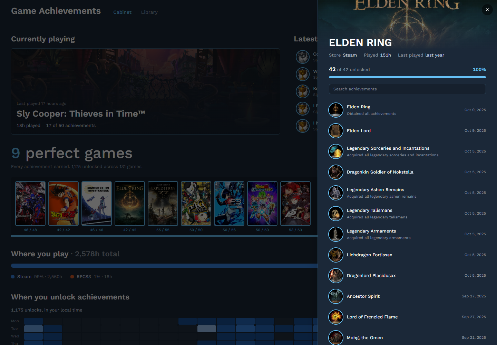

# Game Achievements

A personal trophy cabinet for your Steam library, plus PS3 games played in [RPCS3](https://rpcs3.net): the game you're on, the games you've completed, where your playtime goes, and when you unlock achievements.

It's two small apps. A FastAPI backend proxies the Steam Web API so your API key never reaches the browser, and a React frontend renders the dashboard.



## What you get

- **Cabinet.** The home page:
  - the game you played most recently, with its playtime and achievement progress
  - your latest unlocks across every game
  - a shelf of your perfect games, the ones with every achievement earned, most recently completed first
  - where you play, with your playtime split by store
  - a heat map of the weekdays and hours you unlock achievements
- **Library.** Every game you own as a cover grid. Each card shows a completion bar and when you last played, and perfect games get a highlighted frame. You can search, sort by most played, recently played, name or completion, and filter to games that have achievements.
- **Game detail.** A panel that slides in over the page with the game's achievements, their icons and unlock dates, newest first.





Everything comes from data Steam and RPCS3 already have; nothing is stored. Steam only reports lifetime and last-2-weeks playtime, not daily history, so there are no per-day playtime charts. The heat map is built from achievement unlock times instead.

## Roadmap

- **More platforms.** Steam and RPCS3 are supported today. Other platforms will be added gradually, one at a time.
- **RPCS3 install paths.** The PS3 install locations are currently hardcoded as WSL paths in `RPCS3_ROOTS` (for example `/mnt/e/PS3`). This will be reworked.

## Requirements

- Python 3.10+ and Node.js 22.12+
- A [Steam Web API key](https://steamcommunity.com/dev/apikey)
- Your 64-bit Steam ID (the 17-digit number in your profile URL, or look it up from your vanity URL)

## Setup

### Backend

```bash
python3 -m venv .venv
source .venv/bin/activate
pip install -r backend/requirements.txt
```

Create `backend/.env`:

```env
STEAM_API_KEY=your-api-key
STEAM_ID=your-64-bit-steam-id
# Optional: RPCS3 installs to include, separated by ';'
RPCS3_ROOTS=/mnt/e/PS3;/mnt/e/PS3_AXIS
```

`RPCS3_ROOTS` is optional. Leave it out and the app shows Steam only. Each entry is an RPCS3 install folder (the one that contains `rpcs3.exe`). Under WSL a Windows drive is mounted at `/mnt/<letter>`, so `E:\PS3` becomes `/mnt/e/PS3`.

The app reads RPCS3's files and never writes to them. If you list several installs, they're combined into one library:
- a game listed by more than one install appears once, with its playtime from all installs added together
- a trophy unlocked in any install counts once

Run it from `backend/`:

```bash
cd backend
python run.py        # http://localhost:8000, reloads on change
```

### Frontend

```bash
cd frontend
npm install
npm run dev          # http://localhost:5173
```

The frontend calls `http://localhost:8000` by default. To point it elsewhere, create `frontend/.env` with `VITE_API_URL=...`. If the frontend runs on a different origin, add that origin to the CORS list in `backend/app/main.py`.

## API

| Endpoint | Returns |
|---|---|
| `GET /games` | Owned games with playtime and last-played time, most played first |
| `GET /games/{app_id}/achievements` | One game's achievements, with names, descriptions, icons and unlock times |
| `GET /games/achievements-summary` | Completion and recent unlocks for every game |
| `GET /games/now-playing` | The game you're in right now, or `null`s when you aren't playing |

Steam errors come back as `502`. Achievement lookups are cached in memory for 10 minutes per game. The cache lives in the backend process, so it resets on restart.

The summary endpoint makes one Steam request per game, so the first load of a large library is slow. Tiles that depend on it show a loading state until it finishes.

## Tests

```bash
cd backend && python -m pytest -q     # Steam service, with Steam calls faked
cd frontend && npm test               # stats and formatting helpers, slide-over behaviour
cd frontend && npm run lint && npm run build
```

## Project layout

```
backend/app/
  main.py              FastAPI app and CORS
  routers/games.py     /games endpoints
  services/steam.py    every Steam Web API call
frontend/src/
  api/ hooks/          fetch wrappers and the hooks that load them
  lib/                 pure functions for stats, sorting and formatting (unit tested)
  components/          overview tiles, library grid, slide-over panel
  pages/Home.jsx       the single page: Overview and Library tabs
```
